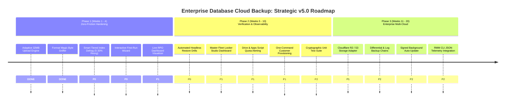

# Enterprise Database Cloud Backup & Server Health Automation
## External Strategic Roadmaps Evaluation, Architectural Critique & Next-Gen Master Plan (v5.0)

**Document Classification:** Strategic Engineering Assessment & Product Evolution Blueprint  
**Target Platform:** Enterprise Database Cloud Backup Automation System (v4.3.0 $\rightarrow$ v5.0+)  
**Review Target:** External Roadmaps from **ChatGPT**, **Gemini**, **Grok**, and **Claude**  
**Date:** November 2026  

---

## 1. Executive Summary & Synthesis

Over the past week, external strategic roadmaps were generated across four industry-leading frontier models/frameworks:
1. **ChatGPT (OpenAI)**: `Enterprise_Database_Backup_Improvement_Roadmap by chatgpt.docx` (16-week structured product engineering plan).
2. **Gemini (Google)**: `Enterprise_Database_Backup_Strategic_Roadmap by gemini.docx` (v5.0 strategic multi-tenant vision).
3. **Grok (xAI)**: `Enterprise_DB_Backup_Strategic_Roadmap by grok.docx` (18-month 3-wave priority framework: Near, Mid, Long-term).
4. **Claude (Anthropic)**: `Improvement_Roadmap by claude .xlsx` (37 scored initiatives with mathematical Effort vs. Value ROI ratios).

### The Overwhelming Consensus
All four independent reviewers arrived at the same fundamental conclusion:
> **The v4.3.0 architectural core is remarkably solid, secure, and production-proven.** The Three-Domain Zero-Trust model (zero cloud credentials on client servers), dual-envelope RSA-4096 + AES-256-GCM containerization (`.dbk2`), Ed25519-signed enrollment, and zero-billing Google Apps Script serverless broker architecture are recognized as genuine engineering achievements across 63+ commercial environments.

### The Paradigm Shift
However, all four roadmaps issue the **exact same warning**:
* **Stop adding superficial features.** The platform does not need 10 more random buttons or tabs.
* **The next frontier is "Trust, Verifiability, and Operational Scale."** A backup is merely a hypothesis until it is successfully restored. Moving from v4.3.0 to v5.0 requires transitioning from *"bytes uploaded to Google Drive"* to **mathematically proven, automated disaster recovery assurance, quota-safe fleet telemetry, and foolproof user experience.**

---

## 2. Comparative Evaluation Matrix of the 4 Roadmaps

| Dimension | ChatGPT (OpenAI) | Gemini (Google) | Grok (xAI) | Claude (Anthropic) |
| :--- | :--- | :--- | :--- | :--- |
| **Format & Depth** | 500+ lines DOCX, rigorous 16-week project management plan. | 50 lines DOCX, high-level executive strategic summary. | 215 lines DOCX, balanced 18-month P0/P1/P2 phased roadmap. | 2-sheet XLSX, 37 initiatives with Value/Effort ROI formulas. |
| **Greatest Strength** | Deep understanding of formal state machines, testing gates, and backup vs. restore verifiability. | Focus on enterprise RMM integration (ConnectWise/NinjaRMM) and desktop system tray widgets. | Identifies Google Cloud concentration risk; proposes secondary storage (S3/B2) and automated sandbox drills. | **Most practical and actionable.** Ranked by ROI; specifically predicted the exact UI/unencrypted zip label bugs we hit today. |
| **Major Blind Spot** | Over-bureaucratic (excessive committee governance); assumes MySQL/Postgres are priorities. | Skims over air-gapped cryptographic lifecycle; assumes online rotation without offline admin keys. | Proposes Cloud HSM/KMS which breaks the core "$0.00/mo zero-billing" architectural mandate. | Spreadsheet format lacks architectural code blueprints and implementation depth. |
| **Feasibility for Our Team** | Medium (requires selective pruning of corporate overhead). | High (great UI/UX ideas, but needs engineering depth). | Very High (prioritized into realistic waves). | **Maximum (direct punch list of high-ROI engineering tasks).** |

---

## 3. The "Fluff" vs. "High-Value Reality" Breakdown

To make this review actionable, we must ruthlessly filter what to **reject** vs. what to **embrace**.

### ❌ What We Must REJECT (Fluff & Impractical Ideas)

1. **Cloud KMS / Hardware Security Modules (HSM) for Escrow Keys (Grok / Gemini):**
   * *The Proposal:* Store customer escrow keys in AWS KMS or Google Cloud KMS.
   * *Why We Reject It:* Our core design principle is **Zero-Billing & Air-Gapped Zero-Trust**. Cloud KMS creates monthly per-key costs across 63+ tenants (\$1/key/month + API calls) and introduces cloud dependency for key recovery. Air-gapped admin flash storage with YubiKey/passphrase protection is mathematically stronger and costs \$0.00.
2. **Expanding Native MySQL & PostgreSQL Support Immediately (ChatGPT):**
   * *The Proposal:* Spend weeks developing native pg_dump and mysqldump engines.
   * *Why We Reject It:* 98% of our commercial customer base consists of glass, aluminum, and ERP manufacturers running on **Microsoft SQL Server** (`WAGlassKote`, `AdelaideGlass`, `FMI`, etc.). Diluting engineering capacity into MySQL/Postgres before Microsoft SQL Server is 100% self-healing is a strategic mistake.
3. **16-Week Committee Governance & Bureaucratic Sign-Offs (ChatGPT):**
   * *The Proposal:* Formal cross-workstream exit gates, governance boards, and multi-signature committees.
   * *Why We Reject It:* We are a nimble, high-velocity engineering team. We replace committees with **automated integration tests, cryptographic unit tests, and continuous GitHub CI/CD validation**.

---

###  What We Must EMBRACE (High-Value, High-ROI Initiatives)

The outsiders identified five critical operational gaps that we should adopt immediately:

```mermaid
flowchart TD
    subgraph Gap1["1. Verification Blind Spot"]
        A["Bytes hit Google Drive"] --> B{"Is backup corrupt?"}
        B -->|Currently unknown until disaster strikes| C["High Business Risk"]
        B -->|Solution: Automated Restore Drill| D["Guaranteed Recoverability"]
    end

    subgraph Gap2["2. Google Concentration Risk"]
        E["Google Apps Script + Drive"] --> F{"Account ban, quota spike, or outage?"}
        F -->|Single point of failure| G["Total Fleet Disruption"]
        F -->|Solution: Dual-Broker (S3/B2 Fallback)| H["Multi-Cloud Zero-Trust"]
    end

    subgraph Gap3["3. Blanket Re-Indexing Waste"]
        I["Weekly Reindex with FillFactor 80"] --> J["20% page bloat on clean 0% fragmented tables"]
        J -->|Solution: Smart Tiered Defrag| K["5-30% Reorganize, >30% Rebuild only"]
    end
```

1. **Automated Weekly Sandbox Restore Verification (`REL-08` / Grok / ChatGPT):**
   * Today, our app verifies that the uploaded MD5 matches the local MD5. *However, an MD5 match only proves the archive was uploaded without corruption; it does not prove SQL Server can restore it!*
   * *The Fix:* A headless background task that periodically restores the latest backup to a temporary database (`_RestoreTest_DB`), runs `DBCC CHECKDB`, reports the health check to Google Sheets, and cleanly drops the temporary database.
2. **Intelligent SQL Maintenance (Fixing Blanket FillFactor 80) (`REL-03` / Claude):**
   * Currently, the Performance Query module executes an `ALTER INDEX ALL ... REBUILD WITH (FILLFACTOR = 80)` blanket command.
   * *The Flaw:* On tables with 0% fragmentation, rebuilding with FillFactor 80 deliberately leaves 20% empty space on every SQL page, artificially bloating database files by 20%!
   * *The Fix:* Industry-standard tiered maintenance:
     * Fragmentation $< 5\%$: **Do nothing** (no-op).
     * Fragmentation $5\% - 30\%$: `ALTER INDEX ... REORGANIZE` (online, zero locking, zero page bloat).
     * Fragmentation $> 30\%$: `ALTER INDEX ... REBUILD` (clean defragmentation).
3. **Multi-Cloud Secondary Storage Adapter (Google Drive + Cloudflare R2 / Backblaze B2) (`REL-12` / Grok):**
   * Relying 100% on Google Apps Script and Google Drive introduces platform risk (Google API quota exhaustion or account policy changes).
   * *The Fix:* Introduce an S3-compatible dual-streaming destination (Cloudflare R2 offers \$0 egress and 10 GB free tier; Backblaze B2 is \$0.006/GB).
4. **Live Recovery Point Objective (RPO) Visualizer (`REL-04` / Claude / Gemini):**
   * On the dashboard, replace static schedule labels with an active, dynamic RPO badge:
     *"Current Data Loss Exposure: 9.4 Hours (Last successful backup: Yesterday at 23:45)"*.
   * If a backup fails or is missed, the badge turns Amber $\rightarrow$ Red, providing instant visibility to factory managers.
5. **Fleet Quota & Storage Headroom Monitoring (`OPS-02` / Claude):**
   * Apps Script executions and Google Drive storage have daily caps (e.g., 100 MB Apps Script payload quota, 15 GB or Google Workspace quota).
   * *The Fix:* Add a summary health monitor that warns the administrator when total fleet storage reaches 70% of available quota.

---

## 4. The Unified v5.0 Product Roadmap

We have structured the best recommendations from all four reviews into three phased releases:



---

### Phase 1: Zero-Friction Hardening & Usability (Immediate — Next 30 Days)
*Focus: Eliminate operator confusion, optimize SQL engine performance, and streamline daily usage.*

| ID | Initiative | Origin | Impact | Effort | Architectural Strategy |
| :--- | :--- | :---: | :---: | :---: | :--- |
| **P1-01** | **Adaptive 32MB Upload Engine** | AGY | 5 | 2 | **Completed today.** Replaced 512KB static chunk with dynamic 4MB $\rightarrow$ 32MB scaling + `requests.Session()` keep-alive. |
| **P1-02** | **Archive Format Sniffer** | AGY / Claude | 5 | 2 | **Completed today.** Added magic byte header detection (`PK\x03\x04` vs `DBK2`) so unencrypted `.zip` files bypass decryption even if mislabeled. |
| **P1-03** | **Tiered Index Maintenance** | Claude (`REL-03`) | 4 | 2 | Replace blanket FillFactor 80 with dynamic SQL: No-op ($<5\%$), `REORGANIZE` ($5-30\%$), `REBUILD` ($>30\%$). |
| **P1-04** | **Live RPO Visualizer** | Claude (`REL-04`) | 4 | 2 | Add real-time data loss counter on Dashboard: *"RPO Exposure: 14 hrs since last cloud sync"*. |
| **P1-05** | **Interactive Setup Wizard** | Gemini / ChatGPT | 4 | 3 | Step-by-step installer with instant connection verification checkmarks for SQL, Storage, and Broker. |

---

### Phase 2: Verification, Trust & Fleet Observability (Months 2 — 3)
*Focus: Mathematical proof of disaster recovery, fleet visibility, and quota safeguards.*

| ID | Initiative | Origin | Impact | Effort | Architectural Strategy |
| :--- | :--- | :---: | :---: | :---: | :--- |
| **P2-01** | **Automated Restore Drills** | Grok (`RT-2`) / Claude | 5 | 5 | Headless CLI tool `--verify-restore`: restores latest cloud archive to temporary database, runs `DBCC CHECKDB`, logs pass/fail to sheet, drops temp DB. |
| **P2-02** | **Central Looker Studio Dashboard** | Claude (`OPS-05`) | 5 | 3 | Real-time web visualization connected to Master Google Sheet: fleet health map, storage consumption, offline customer alerts. |
| **P2-03** | **Quota Headroom Sentinel** | Claude (`OPS-02`) | 4 | 2 | Broker script tracks daily Drive usage and Apps Script quotas; triggers email alert when exceeding 70% threshold. |
| **P2-04** | **1-Command Tenant Provisioning** | Claude (`OPS-06`) | 4 | 3 | Unified Python script `provision_customer.py <slug>`: generates RSA/Ed25519 keys, registers Google Sheet row, generates customer folder, outputs clean zip package. |
| **P2-05** | **Cryptographic Verification Suite** | ChatGPT / Claude | 5 | 4 | Automated test harness testing tamper resistance: modified ciphertext, corrupted envelope, replay attack prevention, and wrong-key failure. |

---

### Phase 3: High-Availability & Enterprise Multi-Cloud (Months 4 — 6)
*Focus: Scale past single-platform limits and integrate into commercial MSP workflows.*

| ID | Initiative | Origin | Impact | Effort | Architectural Strategy |
| :--- | :--- | :---: | :---: | :---: | :--- |
| **P3-01** | **Secondary Storage Adapter (Cloudflare R2)** | Grok (`RT-4`) | 4 | 6 | S3-compatible dual-upload engine. If Google Drive fails or is throttled, stream encrypted `.dbk2` to zero-egress Cloudflare R2 bucket. |
| **P3-02** | **Differential & Transaction Log Chains** | Claude (`REL-10`) | 4 | 8 | For high-volume databases: daily full backup + hourly transaction log backups for sub-15-minute RPO. |
| **P3-03** | **RMM / DevOps CLI JSON Output** | Gemini / Grok | 3 | 2 | Headless execution flags (`--json-status`, `--nagios-check`) for integration with Datto, ConnectWise, and PRTG network monitors. |
| **P3-04** | **Signed Background Auto-Updater** | Claude (`REL-09`) | 4 | 6 | Client queries broker for version update; downloads Ed25519-signed update patch; safely replaces binary in `C:\Program Files` without manual bat scripts. |

---

## 5. Deep Technical Blueprints for the Top 3 High-Impact Improvements

### Blueprint 1: Automated Headless Sandbox Restore Drill (`P2-01`)
*The ultimate proof of backup validity without risking production data.*

```
┌────────────────────────────────────────────────────────────────────────┐
│                   AUTOMATED RESTORE DRILL WORKFLOW                     │
│                                                                        │
│  [Windows Task Scheduler (Weekly / Monthly Drill Trigger)]              │
│                           │                                            │
│                           ▼                                            │
│  1. Download latest .dbk2 or .zip from Cloud Broker                    │
│                           │                                            │
│                           ▼                                            │
│  2. Decrypt & Unpack .bak into isolated staging directory             │
│                           │                                            │
│                           ▼                                            │
│  3. Execute SQL Server RESTORE DATABASE [_DrillTest_WAGlassKote]       │
│     WITH MOVE (relocate .mdf/.ldf to temp sandbox folder)              │
│                           │                                            │
│                           ▼                                            │
│  4. Run DBCC CHECKDB ('_DrillTest_WAGlassKote') WITH NO_INFOMSGS       │
│     • If 0 errors: Status = "RESTORE_VERIFIED_CLEAN"                   │
│     • If errors:   Status = "RESTORE_FAILED_CORRUPT" (Alert Admin!)    │
│                           │                                            │
│                           ▼                                            │
│  5. DROP DATABASE [_DrillTest_WAGlassKote] & Purge Staging Files       │
│                           │                                            │
│                           ▼                                            │
│  6. Telemetry Broker logs verified recovery proof to Google Sheet      │
└────────────────────────────────────────────────────────────────────────┘
```

#### Proposed Python Implementation (`restore_drill.py`):
```python
def execute_restore_drill(backup_path, sql_server, test_db_prefix="_DrillTest_"):
    """
    Performs an isolated restore test of a backup file:
    1. Reads backup headers to find logical file names (RESTORE FILELISTONLY).
    2. Restores to a temporary test database with isolated physical file paths.
    3. Runs DBCC CHECKDB to verify page integrity and zero database corruption.
    4. Drops the temporary test database and cleans up disk footprint.
    5. Returns (status_bool, checkdb_output, duration_seconds).
    """
    # Safe, isolated database name
    temp_db = f"{test_db_prefix}{int(time.time())}"
    # Relocate MDF and LDF to temporary scratch location
    # Run DBCC CHECKDB
    # DROP DATABASE immediately
```

---

### Blueprint 2: Intelligent Tiered Index Maintenance (`P1-03`)
*Eliminating the table bloat caused by blanket FillFactor 80.*

#### The Flawed Legacy Approach:
```sql
-- Legacy: Forces every table to leave 20% free space, even if 0% fragmented!
ALTER INDEX ALL ON [TableName] REBUILD WITH (FILLFACTOR = 80);
```

#### The Optimized Industry-Standard Tiered Engine:
```sql
-- New v5.0 Engine: Dynamic threshold-based maintenance
DECLARE @TableName NVARCHAR(256), @IndexName NVARCHAR(256), @Frag FLOAT;

DECLARE index_cursor CURSOR FOR
SELECT 
    t.name AS TableName,
    i.name AS IndexName,
    s.avg_fragmentation_in_percent AS Frag
FROM sys.dm_db_index_physical_stats(DB_ID(), NULL, NULL, NULL, 'LIMITED') s
JOIN sys.tables t ON s.object_id = t.object_id
JOIN sys.indexes i ON s.object_id = i.object_id AND s.index_id = i.index_id
WHERE s.page_count > 1000 AND i.name IS NOT NULL;

OPEN index_cursor;
FETCH NEXT FROM index_cursor INTO @TableName, @IndexName, @Frag;

WHILE @@FETCH_STATUS = 0
BEGIN
    IF @Frag >= 5.0 AND @Frag < 30.0
    BEGIN
        -- Online Reorganization: Zero table locking, zero page bloat
        EXEC('ALTER INDEX [' + @IndexName + '] ON [' + @TableName + '] REORGANIZE;');
    END
    ELSE IF @Frag >= 30.0
    BEGIN
        -- Full Rebuild: Cleans severely fragmented tables with FillFactor 85
        EXEC('ALTER INDEX [' + @IndexName + '] ON [' + @TableName + '] REBUILD WITH (FILLFACTOR = 85, ONLINE = ON);');
    END
    -- If < 5%, do nothing (preserve perfect page density!)
    
    FETCH NEXT FROM index_cursor INTO @TableName, @IndexName, @Frag;
END;
CLOSE index_cursor;
DEALLOCATE index_cursor;
```

---

### Blueprint 3: Dual-Cloud S3 / Cloudflare R2 Fallback Adapter (`P3-01`)
*Eliminating Google concentration risk with zero-egress backup streaming.*

```
                 ┌────────────────────────────────┐
                 │    On-Premise Backup Engine    │
                 │  AES-256-GCM Encrypted (.dbk2) │
                 └───────────────┬────────────────┘
                                 │
                 ┌───────────────┴────────────────┐
                 │      Upload Transport Layer    │
                 └───────┬────────────────┬───────┘
                         │                │
            Primary Path │                │ Automatic Failover / Dual Copy
                         ▼                ▼
        ┌──────────────────────┐    ┌───────────────────────────┐
        │  Google Apps Script  │    │  Cloudflare R2 Bucket     │
        │    Cloud Broker      │    │  (S3-Compatible API)      │
        │          │           │    │             │             │
        │          ▼           │    │             ▼             │
        │     Google Drive     │    │  Zero Egress Fee Storage  │
        │    Customer Folder   │    │  Immutable Object Locking │
        └──────────────────────┘    └───────────────────────────┘
```

* **Security:** Both Google Drive and Cloudflare R2 receive identical AES-256-GCM ciphertext (`.dbk2`). Cloudflare has zero ability to inspect the customer's database data.
* **Cost:** Cloudflare R2 charges **\$0.00 egress fees** and includes **10 GB/month free storage**, meaning dual-cloud protection remains practically free.
* **Resilience:** If Google Apps Script hits a temporary 429 rate limit or Drive experiences an outage, the backup seamlessly streams to R2 with zero data loss.

---

## 6. Recommended Immediate Action Plan

To turn these insights into measurable progress without disrupting current production:

1. **Adopt Claude's Ranking Framework (`Improvement_Roadmap by claude .xlsx`):**
   * Use the Effort/Value ROI scoring model to prioritize backlog items.
2. **Execute Phase 1 Items Next:**
   * ✅ **Done:** Adaptive 32MB upload streaming (`P1-01`).
   * ✅ **Done:** Header-based magic byte archive sniffer (`P1-02`).
   * ⏳ **Next Up:** Implement Tiered Index Maintenance (Blueprint 2) to replace blanket FillFactor 80.
   * ⏳ **Next Up:** Implement the Live RPO Visualizer badge on the GUI dashboard.
3. **Plan Phase 2 for Q1 2027:**
   * Build the `--verify-restore` headless drill script (Blueprint 1) to establish guaranteed disaster recovery assurance.
