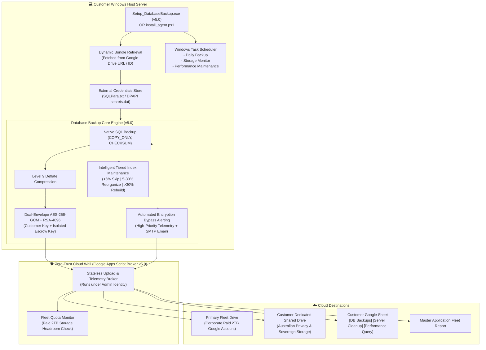
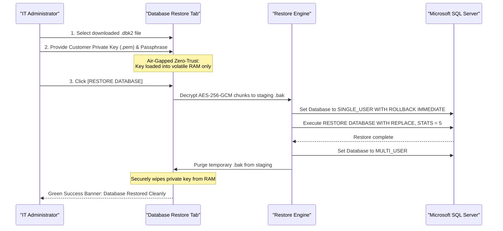
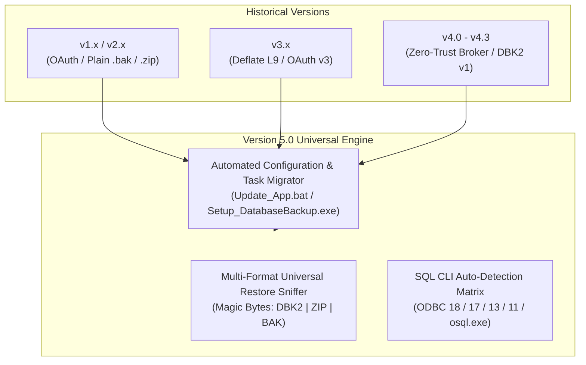

# 📦 Enterprise Database Cloud Backup & Server Health Automation
## Complete Installation, Setup & Operations Guide · Version 5.0.0

**Document Classification:** Production Deployment & System Administration Manual  
**App Version:** `5.0.0` | **Build ID:** `5.0.0-20261104`  
**Package Directory:** [`c:/Users/dulni/OneDrive/Documents/Desktop/idea/Client_Installation_Package_v5.0`](file:///c:/Users/dulni/OneDrive/Documents/Desktop/idea/Client_Installation_Package_v5.0)  
**Target Environments:** Windows Server 2012 / 2016 / 2019 / 2022 / 2025, Windows 10 / 11 (64-bit)  
**Supported Databases:** Microsoft SQL Server (2012 through 2025: Express, Standard, Enterprise)  
**Audience:** Customer System Administrators, IT Operations Teams, SPIL / ERP Deployment Engineers  

---

## 1. System Overview & Architecture Highlights

The **Enterprise Database Cloud Backup Automation Suite (v5.0.0)** is an enterprise-grade, zero-trust database protection and health maintenance platform deployed across 63+ manufacturing, glass, and aluminum fabrication enterprises.



### Core Security & Reliability Guarantees in Version 5.0:
1. **Zero Client Cloud Credentials:** The client machine holds **zero Google OAuth credentials, service account JSONs, or API keys**. All cloud communications stream through one-time, time-limited presigned resumable upload sessions provided by the broker.
2. **One-Way Encryption Only:** The client server holds **only public encryption keys** (`backup_public.pem` and `escrow_public_{slug}.pem`). Even in the event of a full server ransomware breach, attackers cannot decrypt historical or current backups.
3. **Per-Customer Escrow Isolation:** Each customer is provisioned with their own unique escrow keypair. The blast radius of an escrow key is strictly isolated to **1 customer**, eliminating fleet-wide vulnerability.
4. **Externalized Credentials via `SQLPara`:** Plaintext passwords are eliminated from `config.json`. Credentials can be read directly from ERP parameter files (`SQLPara.txt` / `SQLPara.dat`) or Windows DPAPI local machine vaults (`secrets.dat`).
5. **Automated Security Vigilance on Encryption Bypass:** If an operator unchecks Zero-Trust encryption, a confirmation modal requires explicit acknowledgment, an automated high-priority telemetry alert is sent to Google Sheets, and an urgent security email is dispatched to IT administrators.
6. **Intelligent Tiered SQL Maintenance:** Deprecated `DBCC DBREINDEX` and blanket `FillFactor 80` table bloat have been eliminated. Replaced with dynamic SQL:
   - **$< 5% fragmentation:** Skip (preserves 100% page density and zero I/O).
   - **5% – 30% fragmentation:** `ALTER INDEX ... REORGANIZE` (100% online, zero locking, zero ERP downtime).
   - **> 30% fragmentation:** `ALTER INDEX ... REBUILD WITH (FILLFACTOR = 90)` during off-peak windows.
   - Built-in business-hours protection prevents heavy rebuilds between 07:00 and 19:00.
7. **2TB Enterprise Paid Storage & Sovereign Routing:** Full support for dedicated customer Google Drive folders and Shared Drives to guarantee Australian Privacy Act compliance for ERP records.

---

## 2. Prerequisites & Preflight Checklist

Before initiating installation, verify the following prerequisites on the target host:

| Requirement | Specification | Verification Command / Details |
| :--- | :--- | :--- |
| **Operating System** | Windows Server 2012 R2, 2016, 2019, 2022, 2025, or Windows 10/11 (64-bit) | Run `winver` |
| **Administrative Access** | Local Administrator elevation | Required for Windows Task Scheduler and DPAPI |
| **Database Server** | Microsoft SQL Server (2012–2025) | Any edition (Express, Standard, Enterprise) |
| **Network Access** | Outbound HTTPS (Port 443) | Must be able to reach `script.google.com` and `drive.google.com` |
| **Python on Client?** | **NOT REQUIRED** | Built-in compiled runtime in `.exe` or native PowerShell 5.1+ |
| **Disk Staging Space** | Free disk space on staging drive | At least 2.5× the size of the largest database being backed up |

---

## 3. Setup Option A: Graphical Setup Wizard (`Setup_DatabaseBackup.exe`)
*Recommended for Windows Desktop and standard Windows Server environments.*

### Step 1: Launch Elevated Installer
1. Locate `Setup_DatabaseBackup.exe` inside [`Client_Installation_Package_v5.0`](file:///c:/Users/dulni/OneDrive/Documents/Desktop/idea/Client_Installation_Package_v5.0).
2. Right-click `Setup_DatabaseBackup.exe` and select **"Run as administrator"**.
3. Accept the Windows User Account Control (UAC) prompt.

### Step 2: Ingest the Customer Security Bundle (`bundle.json`)
Version 5.0 supports two enrollment paths:

#### Method 1: Dynamic Google Drive Retrieval (Recommended — Zero Static Secrets)
1. In the **Zero-Trust Cloud Broker Configuration** section, locate the **"Optional: Paste Google Drive Share Link or ID"** field.
2. Paste the private Google Drive link or File ID provided by your SPIL / IT Administrator:
   `https://drive.google.com/file/d/1A2B3C4D5E.../view`
3. Click **📥 Fetch from Drive**.
4. The wizard downloads the signed configuration directly into memory, validates its Ed25519 administrative signature, populates the broker endpoint, and displays:  
   `[✓ Bundle successfully retrieved from Google Drive]`.

#### Method 2: Local Pre-Packaged Bundle
If your deployment package already includes `bundle.json` in the same directory, the installer automatically detects and verifies the file. The broker endpoint and enrollment token will display as `(PRE-SEALED)`.

### Step 3: Configure SQL Server Authentication & `SQLPara`
1. **SQL Server Instance:** Enter the local SQL Server instance name (e.g., `localhost`, `.\SQLEXPRESS`, or `SERVERNAME\SQLINSTANCE`).
2. **Authentication Method:**
   - **Windows Authentication:** Leave username and password blank. Ensure the Windows user running the service / task has `db_backupoperator` or `sysadmin` rights in SQL Server.
   - **External SQLPara File (Recommended):** If your ERP already utilizes an external connection file (e.g. `C:\SPIL\SQLPara` or `SQLPara.txt`), place it in `C:\ProgramData\DatabaseBackupApp\SQLPara.txt`. The installer and core engine will automatically load credentials securely without storing passwords in `config.json`.
   - **SQL Server Authentication:** If specifying a dedicated backup user, enter the username (e.g. `db_backup_user`) and password.

### Step 4: Installation Path & Automation Schedule
1. **Install Directory:** Default is `C:\Program Files\DatabaseBackupApp`.
2. **Staging Directory:** Default is `C:\temp\backups` (ensure the drive has adequate free space).
3. **Automated Schedule:** Check **"Enable Automatic Monday 02:00 AM Backup Schedule"** (or customize days/hours in the application after installation).
4. Click **🚀 Install Now**.

The setup wizard will:
- Copy the binaries and runtime libraries into `C:\Program Files\DatabaseBackupApp`.
- Seal the machine broker token using **Windows DPAPI** (LocalMachine scope) into `C:\ProgramData\DatabaseBackupApp\token.dpapi`.
- Apply strict NTFS Access Control Lists (`icacls`) restricting access to `SYSTEM` and `Administrators`.
- Register the scheduled tasks in Windows Task Scheduler.
- Create a desktop shortcut: **Database Cloud Backup**.

---

## 4. Setup Option B: Native PowerShell Agent (`install_agent.ps1`)
*Recommended for headless Windows Server Core, locked-down virtual machines, or environments requiring 100% script transparency.*

### Step 1: Open Elevated PowerShell
Right-click Windows Start and select **Windows PowerShell (Admin)** or **Terminal (Admin)**.

### Step 2: Navigate to `shell_client`
```powershell
cd "c:\Users\dulni\OneDrive\Documents\Desktop\idea\Client_Installation_Package_v5.0\shell_client"
```

### Step 3: Run the Agent Installer Script
```powershell
powershell.exe -NoProfile -ExecutionPolicy Bypass -File .\install_agent.ps1
```

The script will automatically:
1. Validate `bundle.json` using Windows native .NET Cryptography.
2. Generate the hardware machine fingerprint (`SHA-256` of Motherboard UUID + CPU + MAC).
3. Contact the Cloud Broker, complete mutual enrollment, and seal the token into `token.dpapi`.
4. Copy scripts to `C:\Program Files\DatabaseBackupApp`.
5. Register three automated Windows Scheduled Tasks:
   - `DatabaseBackup_AutomatedTask` (Daily database backup & cloud sync)
   - `DatabaseBackup_StorageMonitor` (Hourly disk space and cleanup monitor)
   - `DatabaseBackup_PerformanceMaintenance` (Scheduled tiered maintenance and consistency checks)

---

## 5. Post-Installation Verification & Testing

### Verification Step 1: Launch Application
Double-click the **Database Cloud Backup** icon on the Desktop or launch:
`C:\Program Files\DatabaseBackupApp\DatabaseBackupApp.exe`

### Verification Step 2: Check Dashboard Badges
Verify the top status cards on the **Dashboard**:
- **SQL SERVER:** Displays your connected SQL Server instance and detected database count.
- **ZERO-TRUST CLOUD WALL:** Displays `DBK2 Encrypted (AES-256 + RSA)` in bright blue.
- **AUTO SCHEDULE & RPO:** Displays the next scheduled execution and real-time **RPO Exposure tracking**.
- **SYSTEM STATUS (Top-Right):** Displays a green badge: `● SYSTEM READY`.

### Verification Step 3: Execute a Manual Test Backup
1. On the **Dashboard**, ensure **"Encrypt backup with Zero-Trust DBK2"** is checked.
2. Click **⚡ RUN FULL BACKUP NOW**.
3. Watch the real-time progress bar and telemetry panel:
   - *Phase 1:* Native SQL Server backup created (`.bak`) with `CHECKSUM`.
   - *Phase 2:* Level 9 Deflate compression applied (`.zip`).
   - *Phase 3:* AES-256-GCM chunked encryption applied (`.dbk2`).
   - *Phase 4:* Multi-threaded adaptive 32MB upload streaming to Google Drive.
   - *Phase 5:* SHA-256 / MD5 cloud verification.
   - *Phase 6:* Local temporary files purged (Zero-Footprint).
4. Verify the Google Sheet link generated in the **Live Logs** tab.

### Verification Step 4: Verify Database Maintenance (Tiered Defragmentation)
1. Switch to the **Performance Query** tab.
2. Verify the configuration shows **Auto-Tiered Maintenance** enabled.
3. Click **⚡ Run Maintenance Suite**.
4. Observe the log output:
   - Checks business hours (protects live ERP transactions if run between 07:00–19:00).
   - Measures index fragmentation: skips optimal indexes (<5%), reorganizes slightly fragmented indexes (5–30%), and rebuilds heavily fragmented indexes (>30%).
   - Runs `DBCC CHECKDB` to guarantee physical database health.
   - Refreshes query optimizer statistics via `sp_updatestats`.

---

## 6. Security Features & Policy Enforcement

### 1. Externalizing Credentials with `SQLPara`
To remove all database passwords from `config.json`:
1. Create a text file named `SQLPara.txt` in `C:\ProgramData\DatabaseBackupApp\`.
2. Format the file using standard key-value pairs:
   ```ini
   Server=localhost\SQLEXPRESS
   Database=WAGlassKote
   UID=sa
   PWD=YourStrongPasswordHere
   ```
3. When the application launches, the **Settings** tab will display:  
   `🔒 SQL Credentials externally managed via SQLPara (SQLPara.txt)`  
   and password entry fields will be masked and protected.

### 2. Encryption Bypass Protection
- If an operator unchecks the encryption checkbox on the Dashboard or Auto Schedule tab, the application displays an explicit security confirmation modal.
- If confirmed, an automated **High-Priority Telemetry Alert** is dispatched to the Google Sheet with status `⚠️ ALERT: ENCRYPTION_DISABLED`, and an urgent email alert is sent to the system administrator.
- If your enterprise requires 100% mandatory encryption with no operator bypass permitted, set in `config.json`:
  ```json
  "ENFORCE_ENCRYPTION_POLICY": true
  ```
  This disables the uncheck option entirely and causes the core engine to reject any unencrypted backup attempts.

---

## 7. Disaster Recovery & Database Restoration

When a database needs to be restored from a cloud `.dbk2` backup:



1. Open **DatabaseBackupApp.exe** and click the **Database Restore** tab.
2. In **Card 1**, click **Browse File...** and select the downloaded `.dbk2` file. The format sniffer will display:  
   `Format: Zero-Trust DBK2 Encrypted Archive`.
3. In **Card 2 (Cloud Decryption Credentials)**:
   - Click **Browse Key...** and select your customer private key (`backup_private.pem` or `escrow_private.pem`).
   - Enter your key recovery passphrase.
   *(Note: The private key is held in volatile RAM only for the duration of this restore operation and is never written to disk.)*
4. In **Card 3 (Target SQL Server)**:
   - Select or enter the target database name.
   - Choose whether to overwrite an existing database (`WITH REPLACE`).
5. Click **⚡ EXECUTE ZERO-TRUST RESTORE**.
6. The engine decrypts the backup, restores the database with exclusive connection handling, verifies database integrity, and purges the decrypted staging file.

---

## 8. Package Contents & Binary Inventory

The [`Client_Installation_Package_v5.0`](file:///c:/Users/dulni/OneDrive/Documents/Desktop/idea/Client_Installation_Package_v5.0) directory contains:

| Item | Type | Size | Description |
| :--- | :--- | :--- | :--- |
| **`Setup_DatabaseBackup.exe`** | Executable | ~45.2 MB | Elevated graphical setup wizard with dynamic Drive bundle retrieval. |
| **`AppFiles/`** | Directory | ~120 MB | Production binaries (`DatabaseBackupApp.exe`), `_internal/` runtime, and engine scripts. |
| **`shell_client/`** | Directory | ~50 KB | Pure Windows PowerShell agent (`install_agent.ps1`, `backup_agent.ps1`). |
| **`INSTALLATION_GUIDE_v5.0.md`** | Manual | ~18 KB | Complete administrator and customer deployment manual. |
| **`config.json`** | Configuration | ~1.5 KB | Enterprise v5.0 settings template with `SQLPARA_PATH` and security toggles. |
| **`build_info.json`** | Metadata | 124 B | Authoritative build signature (`5.0.0-20261104`). |
| **`Uninstall.bat`** | Utility | ~7.5 KB | Clean uninstallation script (removes tasks, directories, and shortcuts). |
| **`Update_App.bat`** | Utility | ~12.8 KB | In-place hotfix updater for customer machines with legacy migration. |

---

## 9. Comprehensive Backward Compatibility & Legacy Migration Runbook

The Enterprise Database Cloud Backup system v5.0 is engineered with **strict generational backward compatibility**. Upgrading existing customer servers running any historical release (v1.x, v2.x, v3.x, v4.0–v4.3) requires zero reconfiguration, zero key re-generation, and zero downtime.

### 9.1 Multi-Generational Compatibility Matrix



| Component | Historical Behavior (v1.x - v4.3) | Version 5.0 Handling & Backward Compatibility |
| :--- | :--- | :--- |
| **Authentication Vault** | Stored plaintext in `broker_token.dat` (v4.0) or OAuth `token.json` (v1-v3). | `Update_App.bat` automatically migrates `broker_token.dat` into machine-scoped Windows DPAPI `token.dpapi`, then securely deletes legacy tokens. |
| **Google Cloud Credentials** | Required `credentials.json` and interactive browser consent (v1-v3). | Obsolete Google OAuth credentials are safely purged. Uploads stream through the Zero-Trust Cloud Broker with zero OAuth refresh tokens. |
| **Escrow Encryption Keys** | Global shared `escrow_public.pem` across all tenants (v4.0-v4.3). | The engine inspects `escrow_public_{slug}.pem` first; if absent, it **seamlessly falls back to `escrow_public.pem`**, preserving full escrow compatibility. |
| **Windows Task Scheduler** | Varied names: `DatabaseBackup_AutomatedTask`, `DatabaseBackup_Daily`, `DatabaseBackupApp`. | `Update_App.bat` actively unregisters all historical task names to prevent conflicts, then registers the unified `Database Cloud Backup` task. |
| **Configuration Schema** | Omitted `SQLPARA_PATH`, maintenance time windows, and security toggles. | The updater safely merges new fields with production defaults without modifying existing database lists, schedules, or server names. |
| **Archive Formats** | Raw `.bak`, standard `.zip`, or DBK2 single-envelope archives. | The v5.0 Restore Engine sniffs magic bytes: restores `.bak`, extracts `.zip`, and decrypts both single-key and dual-envelope `.dbk2` files. |

### 9.2 Operating System & SQL Server Compatibility

- **Supported Microsoft Windows Platforms:**
  - Windows Server 2025, 2022, 2019, 2016, 2012 R2, and 2012 (64-bit and 32-bit).
  - Windows 11, Windows 10, and Windows 8.1 / 7 SP1 (with PowerShell 5.1+).
- **Supported Microsoft SQL Server Versions:**
  - SQL Server 2022 (ODBC Driver 18 with automated `-C` TrustServerCertificate negotiation).
  - SQL Server 2019, 2017, 2016 (ODBC Driver 17 and 13).
  - SQL Server 2014, 2012 (ODBC Driver 11 / SQL Native Client).
  - SQL Server 2008 R2, 2008, 2005, 2000 (automated fallback to `osql.exe` and legacy path scanning).
  - Express, Standard, Enterprise, Developer, and Web editions supported out-of-the-box.

### 9.3 In-Place Upgrade Execution Steps

To upgrade an existing customer installation in under 60 seconds:
1. Extract [`Client_Installation_Package_v5.0.zip`](file:///c:/Users/dulni/OneDrive/Documents/Desktop/idea/Client_Installation_Package_v5.0) on the target machine.
2. Right-click **`Update_App.bat`** and select **Run as administrator**.
3. The script automatically:
   - Detects the current installation path from the Windows Registry or Program Files.
   - Halts running background processes safely.
   - Backs up existing `config.json`, keys, and tokens to a secure temporary sandbox.
   - Purges obsolete OAuth tokens and legacy scheduled tasks.
   - Overwrites runtime binaries with v5.0.0.
   - Upgrades `config.json` schema while preserving all customer databases and schedules.
   - Synchronizes the Windows Task Scheduler under `NT AUTHORITY\SYSTEM`.
   - Tightens Windows File ACLs on `token.dpapi` and application directories.

### 9.4 Legacy Operating System Runbook (Windows Server 2008 R2 / 2012 / 2012 R2 & Windows 7 / 8.1)

Customers frequently maintain older mission-critical database hosts running legacy Windows releases. The architecture provides dedicated pathways for these environments:

| Customer Operating System | Recommended Deployment Method | Technical Prerequisites | Key Considerations |
| :--- | :--- | :--- | :--- |
| **Windows Server 2016 - 2025**<br>Windows 10 / 11 | **Option A: Graphical Setup** (`Setup_DatabaseBackup.exe`) | None (Native support) | Modern dark-mode UI with full feature parity. |
| **Windows Server 2012 / 2012 R2**<br>Windows 8.1 | **Option A: Graphical Setup**<br>*or* **Option B: Shell Agent** | KB2999226 (Universal C Runtime) or Visual C++ 2015-2022 | If C++ runtime is missing, fallback to `shell_client` requires zero extra software. |
| **Windows Server 2008 R2 SP1**<br>Windows 7 SP1 | **Option B: Pure PowerShell Shell Agent** (`shell_client/`) | Windows Management Framework 5.1 & .NET 4.5+ | **Zero Python / Zero EXE footprint.** Operates 100% on native Windows assemblies. |
| **32-Bit (x86) Windows** | **Option B: Pure PowerShell Shell Agent** (`shell_client/`) | .NET Framework 4.5+ | Runs natively in 32-bit PowerShell engine with full DPAPI and AES-256 encryption. |

#### Legacy OS Quick-Start Procedure (Using `shell_client`):
1. Navigate to the [`shell_client/`](file:///c:/Users/dulni/OneDrive/Documents/Desktop/idea/Client_Installation_Package_v5.0/shell_client) folder within the customer package.
2. Open an elevated PowerShell prompt (**Run as Administrator**).
3. If running on Windows Server 2008 R2 / 2012, ensure TLS 1.2 is enabled in PowerShell:
   ```powershell
   [System.Net.ServicePointManager]::SecurityProtocol = [System.Net.SecurityProtocolType]::Tls12 -bor [System.Net.SecurityProtocolType]::Tls11 -bor [System.Net.SecurityProtocolType]::Tls
   ```
4. Run the automated headless installer:
   ```powershell
   powershell.exe -ExecutionPolicy Bypass -File .\install_agent.ps1
   ```
   *(The script reads `bundle.json`, enrolls the machine with the broker, seals `token.dpapi`, and registers the scheduled task in `taskschd.msc`).*
5. Execute a test backup:
   ```powershell
   powershell.exe -ExecutionPolicy Bypass -File "C:\Program Files\DatabaseBackupApp\backup_agent.ps1"
   ```

---
*Enterprise Database Cloud Backup Automation v5.0 · Google DeepMind Advanced Agentic Coding*
