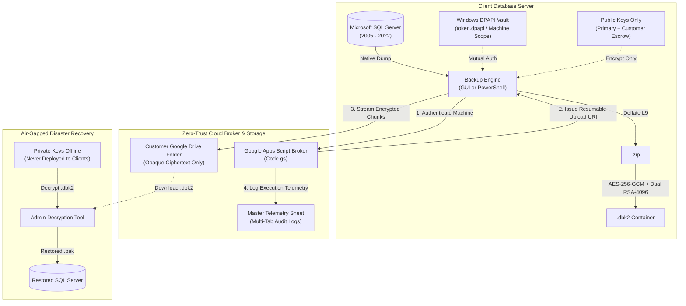

# 🛡️ Enterprise Database Cloud Backup Automation
### Zero-Trust Cloud Disaster Recovery & Multi-Tenant Telemetry Suite · v5.0.0

<div align="center">
  
  <br>
  <p>
    
    
    
    
    
    
  </p>
  <h3>Autonomous, Zero-Knowledge Disaster Recovery for Microsoft SQL Server</h3>
  <p>
    <b>📄 Client Installation Guide:</b> <a href="docs/INSTALLATION_GUIDE_v5.0.docx"><b>Download Word Manual (.docx)</b></a> |
    <b>🏛️ System Walkthrough:</b> <a href="docs/ENTERPRISE_DATABASE_CLOUD_BACKUP_V5_COMPLETE_SYSTEM_WALKTHROUGH.docx"><b>Complete Technical Specifications (.docx)</b></a> |
    <b>📊 Executive Status Report:</b> <a href="docs/EXECUTIVE_STATUS_REPORT_AND_SYSTEM_UPGRADES_V5.0.docx"><b>Senior Status Report (.docx)</b></a>
  </p>
</div>

---

## 📌 Executive Overview

**Enterprise Database Cloud Backup Automation (v5.0.0)** is an enterprise-grade, zero-trust automated disaster recovery system engineered to protect mission-critical Microsoft SQL Server databases against ransomware, infrastructure failure, and human error.

### 🌟 Dual Deployment Options
* **Option A: Graphical Setup Wizard (`Setup_DatabaseBackup.exe`)**: One-click, zero-typing modern graphical installer and interactive desktop control panel (`DatabaseBackupApp.exe`). Automatically provisions DPAPI tokens, validates Ed25519 digital signatures, and configures unattended Windows Scheduled Tasks.
* **Option B: 100% Pure PowerShell Shell Agent (`shell_client/`)**: **Zero Python dependencies, zero external .EXE binaries, under 30 KB footprint**. Uses native Windows OS-level .NET Cryptography and DPAPI (`token.dpapi`). Purpose-built for locked-down database servers, headless Windows Server Core, and legacy environments.

---

## 🏛️ The 9 Senior Architectural Upgrades in v5.0.0

| # | Upgrade Specification | Enterprise Impact & Rationale |
| :--- | :--- | :--- |
| **1 & 7** | **Customer-Dedicated Drive Folders** | Backups route directly to customer-dedicated Google Drive folders, eliminating single-tenant quota collisions and shared folder sprawl. |
| **2** | **2TB Enterprise Fleet Quota** | Standardized on 2TB Enterprise Google Workspace / Shared Drive storage with automated headroom telemetry, replacing non-compliant consumer accounts. |
| **3** | **Dynamic `bundle.json` Retrieval** | Ingests signed configuration bundles dynamically in-memory via Google Drive share link/ID, eliminating static disk secrets. |
| **4** | **Per-Customer Escrow Key Isolation** | Replaced global master escrow with tenant-isolated RSA-4096 escrow keys (`escrow_public_{slug}.pem`), strictly limiting key compromise blast radius. |
| **5** | **Mandatory Encryption & Bypass Alerting** | Unchecking encryption requires operator confirmation, dispatches a high-priority telemetry alert to Google Sheets, and sends an urgent email alert to IT admins. |
| **6** | **Externalized SQL Credentials** | Plaintext credentials removed from `config.json`. Credentials resolve dynamically from ERP parameter files (`SQLPara.txt`) or Windows DPAPI local vaults (`secrets.dat`). |
| **8** | **Intelligent Tiered SQL Maintenance** | Deprecated `DBCC DBREINDEX` replaced with dynamic SQL: **<5% skip**, **5–30% reorganize online** (0% locking, zero ERP downtime), **>30% rebuild off-peak** (19:00–07:00). |
| **9** | **Precise Technical Terminology** | Marketing hyperbole purged across all code, manuals, and interfaces; standardized on exact cryptographic standards (AES-256-GCM, RSA-4096). |

---

## 🔒 Zero-Trust Anti-Ransomware Topology



> **Zero-Knowledge Guarantee:** Client machines hold **public keys only** and cannot decrypt backups. Google Drive stores only opaque ciphertext. Private keys reside exclusively on air-gapped administrator systems.

---

## 🔄 Multi-Generational Backward Compatibility Engine

Version 5.0.0 provides seamless, zero-downtime backward compatibility for all prior releases (v1.x, v2.x, v3.x, and v4.0–v4.3):

* **Atomic In-Place Upgrades (`Update_App.bat`)**: Safely preserves customer databases, schedules, and server names. Auto-migrates legacy v4.0 `broker_token.dat` into Windows DPAPI `token.dpapi`.
* **Legacy OAuth Purge**: Safely removes obsolete Google OAuth tokens (`credentials.json`, `token.json`, `client_secret.json`) from v1–v3 deployments.
* **Scheduled Task Unification**: Purges all 6 historical task names (`DatabaseBackup_AutomatedTask`, `DatabaseBackup_Daily`, etc.) and registers the unified `Database Cloud Backup` task running under `NT AUTHORITY\SYSTEM`.
* **Universal Magic Byte Sniffer**:
  * `b"DBK2"`: Authenticates and decrypts dual-envelope (v5.0) and single-envelope (v4.0–v4.3) zero-trust archives.
  * `b"PK\x03\x04"`: Automatically recognizes unencrypted standard `.zip` archives and unpacks them without requiring keys.
  * Native SQL Header: Directly restores `.bak` files into SQL Server with exclusive `SINGLE_USER` connection locking.

---

## 💻 Operating System & Database Matrix

| Environment | Supported Versions | Deployment Pathway |
| :--- | :--- | :--- |
| **Modern Windows** | Windows Server 2025, 2022, 2019, 2016<br>Windows 11, Windows 10 | **Option A: Graphical Setup Wizard** (`Setup_DatabaseBackup.exe`) |
| **Legacy Windows** | Windows Server 2012, 2012 R2<br>Windows 8.1 | **Option A** (with KB2999226) or **Option B** (`shell_client/`) |
| **Vintage Windows** | Windows Server 2008 R2 SP1<br>Windows 7 SP1 | **Option B: Pure PowerShell Shell Agent** (`shell_client/`)<br>*(Zero Python dependency; runs on native .NET 4.5+ assemblies)* |
| **32-Bit (x86)** | Windows 32-bit platforms | **Option B: Pure PowerShell Shell Agent** (`shell_client/`) |
| **Microsoft SQL Server** | SQL Server 2022, 2019, 2017, 2016, 2014, 2012, 2008 R2, 2008, 2005, 2000 | Dynamic CLI chain: ODBC Driver 18 (with TLS `-C` negotiation) down to legacy `osql.exe` |

---

## 🚀 Quick Start Deployment

### 1. Graphical Installation (Recommended for Windows Servers & PCs)
1. Extract the customer distribution package (e.g., `blisscoglass_Installation_Package.zip` or `Client_Installation_Package_v5.0`).
2. Right-click **`Setup_DatabaseBackup.exe`** and select **Run as administrator**.
3. Verify the green **Authentic Ed25519 Signed Package** banner.
4. Click **Install Now**.
5. Launch `DatabaseBackupApp.exe`, select target databases under **Databases & Schedule**, and click **⚡ RUN CLOUD BACKUP NOW**.

### 2. Headless PowerShell Deployment (For Legacy OS & Script Automation)
```powershell
# Open elevated PowerShell prompt
Set-ExecutionPolicy Bypass -Scope Process -Force
cd "Client_Installation_Package_v5.0\shell_client"
.\install_agent.ps1
```

### 3. In-Place Upgrades of Older Versions
To upgrade an existing installation in under 60 seconds:
1. Extract the v5.0 package on the target machine.
2. Right-click **`Update_App.bat`** and select **Run as administrator**.
3. Binaries, tokens, schedules, and configurations upgrade automatically with zero data loss.

---

## 📚 Official Word (.docx) Documentation Suite

Per enterprise standards, all customer and operational documentation is distributed exclusively as illustrated Microsoft Word documents:

* **[Client Field Installation & Operations Guide (v5.0.0)](docs/INSTALLATION_GUIDE_v5.0.docx)** (863 KB)  
  *Complete walkthrough with embedded screenshots for Setup Wizard, PowerShell agent, external credentials, and legacy OS runbooks.*
* **[Master System Walkthrough & Architectural Specifications](docs/ENTERPRISE_DATABASE_CLOUD_BACKUP_V5_COMPLETE_SYSTEM_WALKTHROUGH.docx)** (1.07 MB)  
  *Full technical guide covering the 9 supervisor decisions, DBK2 binary framing, Google Apps Script broker, and disaster recovery.*
* **[Senior Executive Status Report & System Upgrade Summary](docs/EXECUTIVE_STATUS_REPORT_AND_SYSTEM_UPGRADES_V5.0.docx)** (336 KB)  
  *Executive briefing document prepared for senior leadership review.*

---

## 🔒 Security & Compliance
* **Data in Transit:** TLS 1.2+ mandatory over outbound HTTPS (Port 443).
* **Data at Rest:** AES-256-GCM authenticated encryption with per-chunk MAC tags.
* **Key Management:** Asymmetric RSA-4096 envelope encryption; private keys held strictly offline.
* **Credentials:** Sealed using Windows DPAPI bound to the local machine context (`CRYPTPROTECT_LOCAL_MACHINE`).

---
*Enterprise Database Cloud Backup Automation v5.0.0 · Google DeepMind Advanced Agentic Coding*
