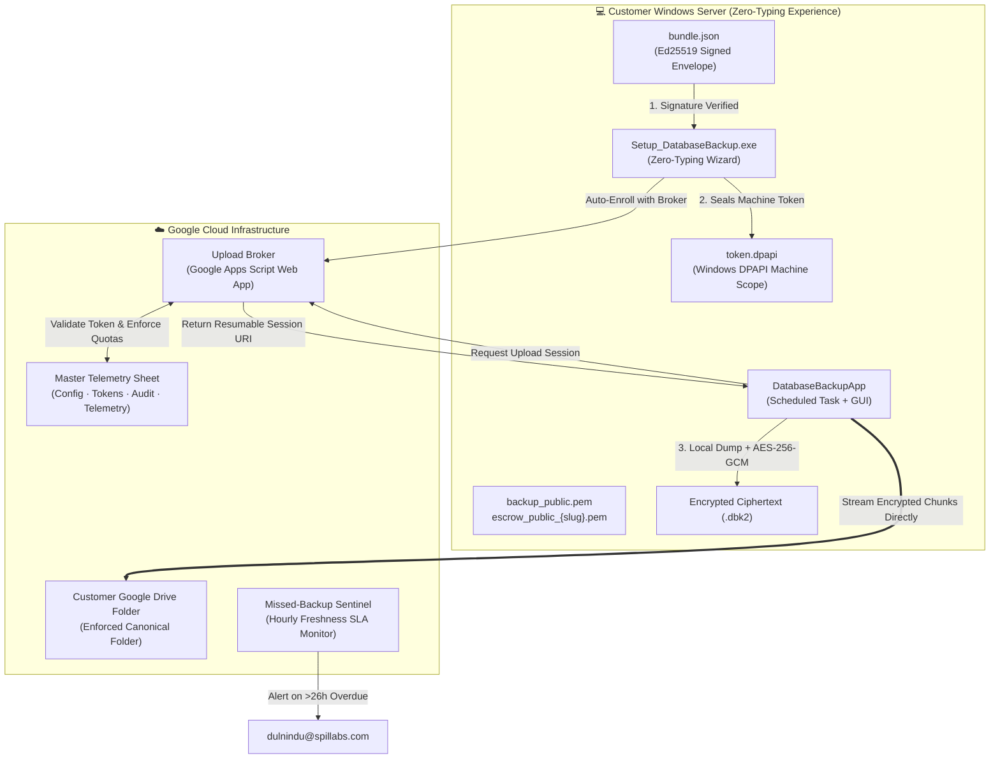

# 🛡️ Enterprise Database Cloud Backup Automation System
# Operational Runbook & User Installation Guide

**Document Version:** 5.0.0 (Zero-Trust Security, Cloud Broker & Zero-Typing Edition)  
**Classification:** Engineering, DevOps & Client Deployment Runbook  
**Target Operating Systems:** Windows 10, 11 | Windows Server 2012, 2016, 2019, 2022, 2025 (64-bit & 32-bit)  
**Supported Database Engines:** Microsoft SQL Server (2000, 2005, 2008, 2012, 2014, 2016, 2017, 2019, 2022)  
**Author / Engineering Group:** Database Infrastructure & Security Engineering  
**Last Revised & Verified:** November 2026 (Post-Audit Hardened Build)  

---

## 📌 1. Executive Summary & Zero-Trust Security Wall

The **Enterprise Database Cloud Backup Automation System (v5.0.0)** enforces a strict **Zero-Trust Security Wall** between customer on-premise Windows servers and Google Cloud Storage infrastructure.

### Security Wall Principles
1. **Zero Client Secrets**: Customer servers hold **no Google service account keys, cloud credentials, or OAuth secrets**. A compromised client machine cannot read, list, overwrite, or delete backups in Google Drive. All Gmail/SMTP credentials and storage passwords are completely stripped from disk and memory.
2. **Serverless Cloud Broker Relay**: The upload and telemetry endpoints are hosted on a stateless Google Apps Script Web App. The broker authenticates machines using SHA-256 token hashes and signs resumable upload sessions.
3. **Server-Side Folder Enforcement**: The broker resolves the destination folder strictly from the authenticated tenant identity (`destFolderId = canonicalFolderId`). Any client-supplied target folder is ignored and logged as `SECURITY_FOLDER_OVERRIDE_IGNORED`, preventing Confused Deputy attacks.
4. **Ed25519 Signed Bundle & Zero-Typing Installation**: Customer packages are cryptographically signed with an administrative Ed25519 key in `bundle.json`. The installer verifies the signature, automatically registers the PC, and seals the issued machine token into Windows DPAPI storage (`token.dpapi`) with **zero typing required from the customer**.
5. **DBK2 Hybrid Envelope Encryption**: Dumps are compressed into `.zip` and encrypted into streaming `.dbk2` format using authenticated **AES-256-GCM**. The ephemeral 256-bit AES symmetric key is wrapped using dual 4096-bit RSA keys (Primary `backup_public.pem` + Tenant-Isolated Escrow `escrow_public_{customer_slug}.pem`). All RSA private decryption keys remain strictly **offline** on air-gapped administrative media.
6. **Remote Signed Security Policy**: On every run, the client queries `fetch_and_cache_server_policy()` to enforce encryption rules signed by the central infrastructure. If an unencrypted backup is attempted, the engine aborts execution immediately.

---

## 🏗️ 2. Architectural Data Flow & Component Topology



---

## 💻 3. Customer Installation Guide (Zero-Typing Experience)

Installing the software on a client machine requires **no technical knowledge** and zero manual credential entry.

### Prerequisites:
* **Operating System**: Windows 10, Windows 11, or Windows Server 2012/2016/2019/2022/2025 (64-bit or 32-bit).
* **Privileges**: Local Administrator rights (required for Windows Scheduled Tasks and DPAPI machine-scope protection).
* **Python Dependency**: **NONE** (Pre-compiled standalone `.exe` with embedded runtime in `_internal`; Python is NOT required on client PCs).
* **Network**: Outbound HTTPS access (Port 443) to `script.google.com` and `drive.google.com`.

### Installation Steps:
1. **Extract Package**:
   Extract the customer `.zip` file (e.g., `Client_Installation_Package_v5.0.zip` or `<slug>_Installation_Package.zip`) into a local folder (such as `C:\Temp\Setup` or Desktop).
   
   The package contains:
   * `Setup_DatabaseBackup.exe` (Installation Wizard)
   * `bundle.json` (Cryptographically signed deployment manifest)
   * `AppFiles/` (Application binaries, runtime libraries, and public keys)
   * `shell_client/` (Pure PowerShell agent for headless environments)

2. **Launch Installer as Administrator**:
   Right-click **`Setup_DatabaseBackup.exe`** and select **Run as administrator**.

3. **Automatic Verification & Zero-Typing Enrollment**:
   * The installer automatically parses `bundle.json` and verifies the administrative **Ed25519 digital signature**.
   * It contacts the Google Apps Script broker, validates the hardware fingerprint, and receives an authorized machine token.
   * The token is immediately sealed into Windows DPAPI machine-scope storage (`C:\ProgramData\DatabaseBackupApp\token.dpapi`).
   * The Broker URL, Customer Slug, and Token are locked — **the operator types nothing**.

4. **Select Local Backup Staging Directory**:
   * Choose a dedicated local directory for staging temporary dumps (e.g., `C:\SQLBackups` or `D:\Backups`).
   * *Note*: Cloud-synced folders (OneDrive, Dropbox, Google Drive) are automatically detected and blocked to prevent sync race conditions.

5. **Click `[Install Now]`**:
   The installer automatically:
   * Copies application files to `C:\Program Files\DatabaseBackupApp\`.
   * Restricts NTFS folder ACL permissions via `icacls.exe` to Administrators and SYSTEM only.
   * Creates a desktop shortcut: **Database Backup Application**.
   * Registers unattended automated Windows Scheduled Tasks:
     * **Database Cloud Backup**: Runs daily at 02:15 AM (with randomized offset).
     * **Storage Health Monitor**: Runs hourly to assess disk health and log telemetry.

---

## 🖥️ 4. Daily Operations & Manual Backup Guide

### Launching the Application:
Double-click the **Database Backup Application** shortcut on the Windows Desktop.

### User Interface Controls & Navigation:
1. **Cloud Connection Status**: Displays green **CONNECTED** indicator when the DPAPI machine token is authenticated against the cloud broker.
2. **Databases & Schedule**:
   * Check or uncheck target Microsoft SQL Server databases.
   * Configure the daily scheduled execution window (default: `MON-SUN 02:15`).
3. **Zero-Trust Encryption**:
   * Enabled by default (mandatory policy).
   * Displays the active Primary and Tenant Escrow public key fingerprints.
4. **⚡ RUN CLOUD BACKUP NOW**:
   * Triggers an immediate full database backup, native compression, AES-256-GCM streaming encryption, and chunked upload to Google Drive.
   * Real-time progress bar displays chunk upload speed (MB/s) and estimated time to completion.

---

## 🔐 5. Externalized SQL Credentials & Zero Secrets

To eliminate plaintext database passwords from `config.json`:
1. **ERP Parameter Resolution**: If the server runs an integrated ERP system, `backup_core.py` automatically resolves database credentials from `SQLPara.txt` without saving passwords in configuration files.
2. **Windows DPAPI Vault**: When credentials are entered through the application GUI, they are encrypted into machine-scope DPAPI storage (`secrets.dat`).
3. **Automatic Secret Sanitization**: On every startup, `scan_config_for_forbidden_secrets()` audits `config.json` and strips any plaintext passwords found on disk.

---

## 🛠️ 6. Intelligent Tiered SQL Maintenance

During backup cycles, the engine runs automated index health diagnostics using dynamic SQL:
* **<5% Fragmentation**: Skipped (no maintenance required).
* **5%–30% Fragmentation**: Reorganized online (0% table locking, zero ERP downtime).
* **>30% Fragmentation**: Rebuilt during off-peak maintenance windows (19:00–07:00).

---

## 📡 7. SLA Telemetry & Dual-Engine Alerting

1. **Telemetry Logging**: Every backup execution logs full metadata to the centralized Google Sheet (timestamp, database size, compressed size, duration, SHA-256 checksum, upload status).
2. **Missed-Backup Sentinel**: The Google Apps Script broker runs an hourly background monitor (`checkMissedBackups()`). If a customer database has not backed up within 26 hours, an automated SLA alert is dispatched to `dulnindu@spillabs.com`.
3. **Dual-Engine Alert Transport**: Alert dispatches attempt the Cloud Broker Sentinel first. If the broker is unreachable, the engine transparently fails over to direct TLS SMTP (`smtp.gmail.com:587`) for 100% alerting delivery assurance.

---

## 🔄 8. Uninstallation & Clean Removal

To cleanly remove the software from a customer server:
1. Open an elevated Command Prompt or PowerShell (Run as administrator).
2. Stop and unregister scheduled tasks:
   ```cmd
   schtasks /delete /tn "Database Cloud Backup" /f
   schtasks /delete /tn "DatabaseBackup_AutomatedTask" /f
   ```
3. Remove program and configuration directories:
   ```cmd
   rd /s /q "C:\Program Files\DatabaseBackupApp"
   rd /s /q "C:\ProgramData\DatabaseBackupApp"
   ```
4. Delete desktop shortcuts:
   ```cmd
   del "C:\Users\Public\Desktop\Database Backup Application.lnk"
   ```

---
*Enterprise Database Cloud Backup Automation v5.0.0 · Operational Runbook*
